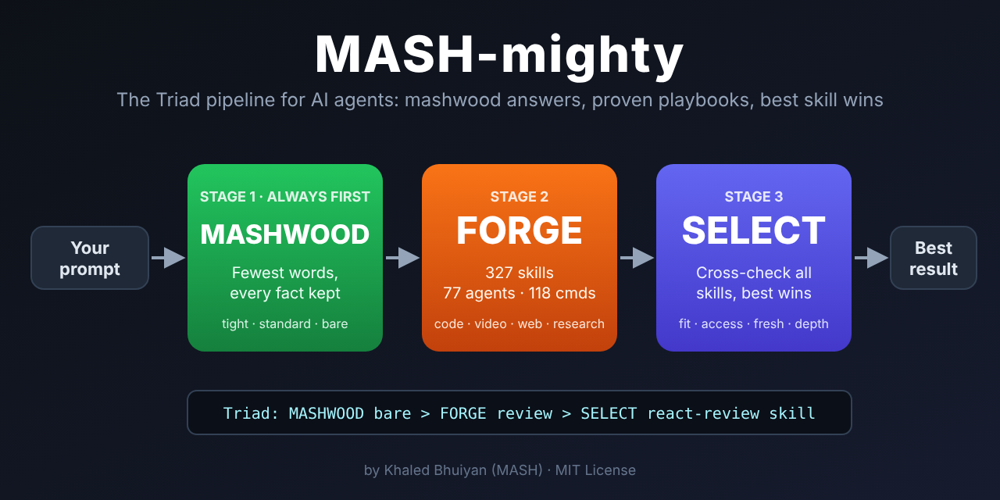

# MASH-mighty


**The Triad toolkit for AI agents: mashwood answers, proven playbooks, best skill wins.**



MASH-mighty runs every prompt through three fixed stages:

| Stage | What it does |
|---|---|
| **1. MASHWOOD** (always first) | Shortest reply that keeps every fact, error, path, number and command. Levels: TIGHT, STANDARD, BARE. Fewer tokens, faster reading. |
| **2. FORGE** | Picks the right tool from the MASH-mighty toolkit: 327 skills, 77 agents, 118 commands. |
| **3. SELECT** | Compares FORGE's pick with every other skill, plugin and tool the agent has (fit, access, freshness, depth, cost). The best one wins; the MASH-mighty DONE check still applies. |

Every reply opens with a trace, so you see what ran:

```
Triad: MASHWOOD bare > FORGE nextjs-build-fix > SELECT nextjs-build-fix
```

## What's inside

| Part | Count | Highlights |
|---|---|---|
| Stack skills | 180 | patterns, review, testing and build-fix for 45 stacks: TypeScript, React, Next.js, Vue, Angular, Svelte, Node, NestJS, Python, Django, FastAPI, Flask, Tkinter, PyTorch, pandas, Spring, Kotlin, Swift, Flutter, React Native, Go, Rust, C/C++, .NET, Laravel, Rails, PostgreSQL, MySQL, MongoDB, Redis, Prisma, Supabase, Firebase, Docker, Kubernetes, Terraform, GitHub Actions, AWS, Vercel, Tailwind, Electron, MATLAB, LaTeX |
| Task skills | 145 | **text-to-video, auto-video-edit, bangla-music-subtitles, one-prompt-website, animated-premium-website, search-console-questions, design-director**, reels, storyboards, ffmpeg recipes, code review, security audit, deploy, RAG, agents, literature review, reviewer responses, pitch decks, pricing, social calendars, Bangla Unicode and translation, PDFs, CVs, lesson plans and more |
| Core skills | 2 | `mash-mighty` (Triad router), `mashwood-mode` |
| Agents | 77 | 45 stack reviewers + 32 specialists (architect, security guardian, video producer, subtitle specialist, web builder, research scientist, academic editor, grant advisor and more) |
| Commands | 118 | `check-STACK` (build + tests + review) and `start-TASK` (launch a workflow) |
| Hooks | 4 | Triad reminder each prompt, shell safety guard (blocks disk wipes, asks before force-push or DROP), secret scan after file edits |

Full list: [`skills/mash-mighty/references/catalog.md`](skills/mash-mighty/references/catalog.md)

## Install

### Claude Code (full toolkit with hooks)
```
/plugin marketplace add kdbn121/mash-mighty
/plugin install mash-mighty@mash-mighty
/reload-plugins
```

### Claude app (web or desktop)
1. Download `mash-mighty.plugin` from [Releases](../../releases).
2. Open **Settings > Plugins > Add > Upload a plugin** and choose the file.
3. In a new chat type `/mash-mighty`.

### Just the router skill (any agent that reads SKILL.md)
Copy `skills/mash-mighty` (and optionally `skills/mashwood-mode`) into your agent's skills folder, for example `~/.claude/skills/`.

## Use

| You type | What happens |
|---|---|
| `/mash-mighty fix the build` | MASHWOOD > stack build-fix skill > best match |
| `/mash-mighty:start-text-to-video 30s reel about our app` | Script, scenes, prompts, voice, music, captions |
| `/mash-mighty:start-bangla-music-subtitles song.mp3` | Timed Bangla SRT or karaoke ASS |
| `/mash-mighty:start-one-prompt-website bakery in Leeds` | Complete responsive site |
| `/mash-mighty:check-nextjs` | Build, tests and review for a Next.js app |
| `/mash-mighty:start-search-console-questions mysite.com` | Question regex + ranked content plan from real Google queries |
| `/mash-mighty:start-animated-premium-website law firm in Manchester` | Agency-level animated site, deploy-ready |
| `mashwood tight` / `mashwood standard` / `mashwood bare` | Change reply length |
| `mashwood off` or `normal mode` | Turn MASHWOOD off |

Turn off the per-prompt reminder hook with the environment variable `MASH_MIGHTY=off`.

## Personalise

Copy `skills/mash-mighty/references/project-profiles-template.md` to `project-profiles.md` and add your projects, stacks and house rules. Keep private details out of public copies.

## Repository layout

```
.claude-plugin/   plugin.json, marketplace.json
skills/           327 skills (one folder each, SKILL.md inside)
agents/           77 agents
commands/         118 commands
hooks/            hooks.json
scripts/hooks/    triad-context.js, guard-bash.js, secret-scan.js
assets/           triad.svg, triad.png
LICENSE           MIT
```

## License

[MIT](LICENSE) © 2026 Khaled Bhuiyan (MASH). Free to use, change and share. Keep the copyright notice.
